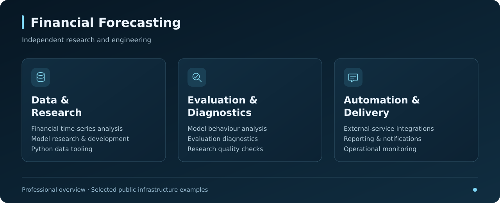

# 📊 Crypto BTC Trend Prediction

An independently developed machine-learning project for financial time-series forecasting. The work combines quantitative research with practical software engineering: market-data tooling, model development, evaluation, automated reporting, and external-service integrations.

Originally built around Bitcoin trend predictions, the project has evolved beyond its early public prototype. I own its research direction, technical decisions, implementation, and ongoing development. This repository presents selected infrastructure examples and an overview of the work; the current research implementation and trained models are maintained privately.

  

## 👨‍💻 Research & Engineering Ownership
- Developed the project independently, covering financial ML research, application development, and integration.
- Built tools for acquiring market data, working with financial time series, and delivering model outputs to external services.
- Investigated model behaviour, data quality, and the reliability of experimental results.
- Developed reporting, notification, and monitoring tools to support continued research and prototype operation.

## 📍 Current Status — November 2026
Production-deployed forecasting system operating across multiple financial assets, with automated market-data processing, prediction delivery, and monitoring.

## 🌟 Research & Engineering
- **Financial ML Research**: Development and investigation of learning-based approaches to financial forecasting.
- **Evaluation & Diagnostics**: Tools for assessing model behaviour and checking the reliability of experiments.
- **Data Engineering**: Python tooling for market-data acquisition, dataset maintenance, and research workflows.
- **Application Integration**: Software connecting research outputs with reporting and external services.
- **Operational Automation**: Scheduled tasks, notifications, and monitoring for ongoing prototype operation.

**Technology experience:** Python · TensorFlow · Keras · pandas · NumPy · API integrations.

*Selected areas of work across research, evaluation, and software delivery.*

## 🧠 Engineering Challenges
- Turning iterative ML research into maintainable Python applications.
- Coordinating market-data updates, application state, and external-service integrations.
- Building diagnostics that make model behaviour and operational failures observable.
- Maintaining research tooling and reporting while the project evolves.

## 🛠️ Selected Public Infrastructure
The remaining scripts are historical examples of supporting software:
- `get_quotations.py`: Market-data acquisition through an exchange API.
- `x_post.py`: Reporting and publishing integration for X.
- `farc_post.py`: Reporting and publishing integration for Farcaster.

The full research application, model preparation, and inference implementation are outside this public showcase.

## 📁 Repository Contents
- `get_quotations.py`, `x_post.py`, `farc_post.py`: Selected integration examples.
- `images/predictive-cover-v1.png`: Conceptual cover illustration.
- `images/forecasting-overview.svg`: Research and engineering overview.
- `.gitignore`: Exclusions for research artifacts and runtime outputs.

## 🚀 Next Steps
- Continue research and paper-trading evaluation.
- Develop diagnostics and operational tooling.
- Prepare further deployment based on the evaluation process.

## 🤝 Research & Collaboration
For financial ML research, Python development, data tooling, and automation projects:

[GitHub](https://github.com/Tim1l) · [LinkedIn](https://www.linkedin.com/in/tim-izmailov-a53524283/) · [Upwork](https://www.upwork.com/freelancers/~01d554f7011bd884f2)
